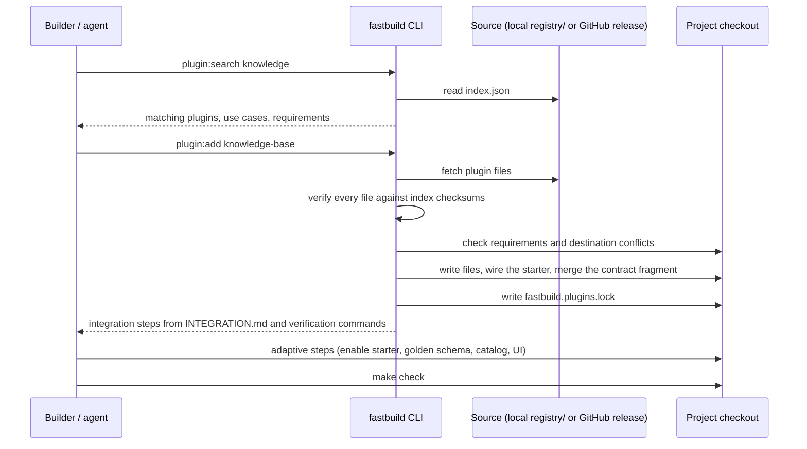

# Plugin Registry — Phase 1 Implementation Plan

Realizes the "Plugin" building block in [VISION.md](../VISION.md). Vocabulary follows
[CONTEXT.md](../../CONTEXT.md); this plan adds the terms in section 5.

## 1. Executive Summary

**Outcome.** A builder working with a coding agent asks for a capability ("we need a knowledge
base"). The agent finds a matching official plugin, installs it as source with one command,
completes the adaptive integration steps the plugin documents, and proves the result with the
repository's checks. The project owns the installed code, and a lock file records exactly what was
installed so later updates can be compared instead of lost.

**Problem.** Today every optional capability ships inside the core as a starter, so the core grows
with each one, and anything not shipped must be improvised by the agent without a reviewed
reference. There is no way to distribute a reviewed capability without making every project carry it.

**In scope.**

1. Plugin manifest v1 and an in-repository official registry under `registry/`, with a generated,
   checksummed index.
2. CLI commands: `plugin:search`, `plugin:info`, `plugin:add`, `plugin:status`, and the maintainer
   command `plugin:index`.
3. A lock file, `fastbuild.plugins.lock`, written by `plugin:add` and read by `plugin:status`.
4. Remote sources: a project created by `make init-project` installs plugins from the FastBuild
   release it started from; the scaffold repository installs from its local `registry/`.
5. The first official plugin, `knowledge-base`: organization-scoped articles with full-text and
   substring search.
6. A `plugin-integration` skill that teaches coding agents to choose, install, integrate, and verify.
7. A test that installs every official plugin into a copy of the API and builds and tests it, so a
   core change cannot silently break a plugin.

**Non-goals (phase 1).** Third-party registries and signatures; `plugin:update` and three-way merge;
`plugin:remove`; Web and Admin UI for plugins (phase 2 ships frontend registry items in the shadcn
registry format); runtime installation from the Admin Console (never: code is added at build time);
embeddings and vector search for the knowledge base (phase 2, behind an adapter); themes, blocks,
and templates.

**Deployable units.** `api/` (CLI, registry tooling, plugin code once installed) and `contracts/`
(fragment merge). `web/` and `admin/` are unchanged.

**Success signal.** In a project created with `make init-project`, an agent runs
`fastbuild plugin:add knowledge-base`, follows the plugin's integration steps, and
`make check` passes; with `OPTIONAL_STARTERS` including `knowledge`, an organization admin creates an
article and a member finds it with `GET /v1/knowledge-search?q=...`, including a Chinese substring.

## 2. Actors and Access Surfaces

| Actor | Goal | Entry points | Read scope | Mutation scope | Approval | Denial behavior |
|---|---|---|---|---|---|---|
| Builder (developer or coding agent) | Add a capability to a project | `fastbuild plugin:*` in the project checkout | Registry index and plugin files of the configured source | Files in the checkout and `fastbuild.plugins.lock` | None; the builder reviews the diff | Non-zero exit with a specific message; no partial writes |
| Scaffold maintainer | Publish official plugins | `fastbuild plugin:index`, pull requests to `registry/` | Whole repository | `registry/` | Code review and CI | CI fails on a stale index or a plugin that does not build |
| Organization member (installed `knowledge` starter) | Read and search knowledge | `GET` knowledge routes with `Organization-Id` | Articles of the active organization | None | — | `403 PERMISSION.DENIED` outside the organization context; `404` for other organizations' articles |
| Organization owner or admin | Curate knowledge | Knowledge write routes | Same as member | Articles of the active organization | — | `403 PERMISSION.DENIED` for members |

## 3. End-to-End Workflows

### 3.1 Find and install a plugin



1. **Preconditions.** The command runs inside a FastBuild checkout (`api/go.mod` and
   `contracts/openapi.yaml` exist). The source resolves: `--source` when given; otherwise the local
   `registry/` when present; otherwise `github:fastagi/fastbuild@<scaffold_version>` from
   `.fastbuild-project.json`.
2. **Validation.** The plugin name exists in the index; the plugin's `fastbuild` version range
   includes the project's scaffold version; every required starter exists in the project; the plugin
   is not already locked.
3. **Integrity.** Every file's SHA-256 matches the index. Archives are bounded (50 MiB compressed,
   2,000 entries, no absolute paths, no `..`, no symlinks).
4. **Conflicts.** Any destination file that exists with different content aborts the install before
   anything is written. An identical existing file is accepted.
5. **Writes.** Files are written, the Go starter is wired with the same edits as `make:module`, and
   the contract fragment is merged with `contracts/scripts/merge-fragment.mjs` when Node.js is
   available; otherwise it stays in `contracts/fragments/` and the merge appears as an integration
   step.
6. **Rollback.** If wiring or the merge fails, written files are removed and edited files restored
   from the copies taken before the write; the lock is not written.
7. **Result.** The lock records the plugin; the CLI prints the plugin's integration steps.
8. **Retries.** Re-running after a failure is safe because nothing was kept. Re-running after success
   fails with "already installed".

### 3.2 Check installed plugins

`plugin:status` reads the lock and reports, per plugin, files that are unchanged, modified, or
missing. Modified files are expected (the project owns the code); the report exists so a later
update knows what to merge.

### 3.3 Knowledge base (installed plugin)

An owner or admin creates, edits (with `If-Match`), and deletes articles in the active organization.
Members list articles newest first in keyset pages, read one, and search. Search returns at most 20
ranked results and never discloses other organizations' articles. Every write records an audit change.

## 4. Module Decomposition

| Module | Responsibility | Inputs | Outputs | Data ownership | Dependencies | Consumers | Priority |
|---|---|---|---|---|---|---|---|
| Plugin registry (CLI capability) | Resolve sources, verify, install, lock, report | CLI commands | Files, lock, reports | `fastbuild.plugins.lock`, `registry/index.json` (generated) | Starter wiring, contract merge script | Builders, CI | P0 |
| `knowledge` starter (installed by the plugin) | Article lifecycle and search | HTTP requests | Responses, audit changes | `knowledge_articles` | `organization` starter, audit change seam | Web/Admin later, API clients | P0 (proof plugin) |
| `plugin-integration` skill | Agent workflow | User requests | Agent actions | — | CLI | Coding agents | P0 |

The registry is a technical capability: it owns no HTTP route. Exclusions: it never executes plugin
code and never modifies files outside the checkout.

## 5. Domain Model and Vocabulary

- **Plugin** — a versioned, self-contained capability distributed as source from a registry and
  owned by the project after installation. A plugin usually installs one optional starter.
- **Registry** — a directory or release archive holding plugins and a generated `index.json`.
- **Plugin manifest** — `plugin.json`: identity, version, compatibility, requirements, the starter it
  installs, files, contract fragment, environment variables, and agent hints (`use_when`).
- **Lock file** — `fastbuild.plugins.lock`: per installed plugin, its version, source, and the
  SHA-256 of every installed file at install time.
- **Integration steps** — the plugin's `INTEGRATION.md`: adaptive work an agent performs after the
  deterministic install, each with a verification command.
- **Knowledge article** — an organization-owned document with a title and Markdown body, versioned
  for optimistic concurrency, searchable by words and substrings.

## 6. Persistence Design

**Lock file** (JSON, repository root, sorted keys, committed to the project):

```json
{
  "version": 1,
  "plugins": {
    "knowledge-base": {
      "version": "0.1.0",
      "source": "github:fastagi/fastbuild@v0.25.0",
      "starter": "knowledge",
      "files": { "api/internal/modules/knowledge/service.go": "<sha256>" }
    }
  }
}
```

**`knowledge_articles`** (migration installed by the plugin; owner `knowledge`):

| Column | Type | Rules |
|---|---|---|
| `id` | `bigserial` | Primary key |
| `organization_id` | `bigint` | Not null; FK `organizations(id) ON DELETE CASCADE` |
| `title` | `varchar(200)` | Not null; check `char_length(title) BETWEEN 1 AND 200` |
| `body` | `text` | Not null, default empty; check `char_length(body) <= 200000` |
| `created_by`, `updated_by` | `bigint` | Nullable; FK `users(id) ON DELETE SET NULL` |
| `version` | `bigint` | Not null, default 1; optimistic concurrency |
| `created_at`, `updated_at` | `timestamptz` | Not null, UTC |
| `search_vector` | `tsvector` | Generated stored: weighted `simple` configuration of title (A) and body (B) |

Indexes: `(organization_id, id)` for keyset pages and GIN on `search_vector`. Substring search for
languages without word spacing, such as Chinese, uses `ILIKE` within the organization's own rows
and needs no database extension, so the plugin installs on managed PostgreSQL without extra
privileges; very large collections move to vector search in phase 2. Rollback drops the table. No
seed data. Deleting an organization deletes its articles.

## 7. State Machines

Plugin installation has no persisted lifecycle: a plugin is either absent or locked. A failed install
leaves it absent (section 3.1, step 6).

Knowledge articles have no states beyond existence; `version` increments on each update. Deletion is
a hard delete.

## 8. HTTP Contract Design

The plugin ships `contracts/KNOWLEDGE.md` and an OpenAPI fragment merged into the project's
contract on install. All routes require `auth` and `organization_context`.

| Method and path | Who | Behavior |
|---|---|---|
| `GET /v1/knowledge-articles` | Members | Keyset page, newest first; `cursor`, `per_page` 1–100 |
| `POST /v1/knowledge-articles` | Owner, admin | Create; `201` with `ETag: "knowledge-article-v1"` |
| `GET /v1/knowledge-articles/{id}` | Members | Read with `ETag` |
| `PATCH /v1/knowledge-articles/{id}` | Owner, admin | Partial update; requires `If-Match` |
| `DELETE /v1/knowledge-articles/{id}` | Owner, admin | `204`; requires `If-Match` |
| `GET /v1/knowledge-search?q=` | Members | Up to 20 results ranked by text rank, then recency |

Errors: `400 COMMON.INVALID_INPUT`, `401 AUTH.UNAUTHORIZED`, `403 PERMISSION.DENIED`,
`404 KNOWLEDGE.ARTICLE_NOT_FOUND` (also for other organizations' IDs), `412 KNOWLEDGE.VERSION_CONFLICT`,
`422 COMMON.VALIDATION_FAILED`, `422 KNOWLEDGE.INVALID_ARTICLE`, `428 KNOWLEDGE.PRECONDITION_REQUIRED`,
`503 COMMON.SERVICE_UNAVAILABLE`. Plugin error codes live in the plugin's module and reach the
contract through the fragment's `x-error-codes`, so installing a plugin never edits core files.

```text
COMMAND UpdateArticle(actor, id, request, if_match)
BIND actor, organization FROM authenticated_context
VALIDATE request: title 1-200 chars after trimming when present, body <= 200000 chars when present,
  at least one field ELSE KNOWLEDGE.INVALID_ARTICLE
REQUIRE organization.role IN {owner, admin} ELSE PERMISSION.DENIED
REQUIRE if_match PRESENT ELSE KNOWLEDGE.PRECONDITION_REQUIRED
DERIVE expected_version = parse(if_match) OR ELSE COMMON.INVALID_INPUT
BEGIN TRANSACTION knowledge
  CAS_UPDATE article WHERE id = id AND organization_id = organization.id EXPECT expected_version
    SET fields, updated_by = actor, version = version + 1
    ELSE IF no row in organization THEN KNOWLEDGE.ARTICLE_NOT_FOUND
    ELSE KNOWLEDGE.VERSION_CONFLICT
COMMIT
AFTER COMMIT record audit change (article id, changed field names; no body text)
RETURN 200 article WITH ETag
```

```text
QUERY SearchArticles(actor, q)
BIND actor, organization FROM authenticated_context
VALIDATE q: trimmed, 1-200 chars
LOAD up to 20 articles FROM knowledge
  WHERE organization_id = organization.id
    AND (search_vector @@ websearch_to_tsquery('simple', q)
         OR title ILIKE %q% OR body ILIKE %q%)   -- q escaped for LIKE
  ORDER BY ts_rank_cd(search_vector, query) DESC, id DESC
RETURN 200 results with title and a body excerpt (first 240 characters)
```

## 9. Authorization Matrix

| Operation | Member | Admin | Owner | Outside the organization |
|---|---|---|---|---|
| List, read, search | Allowed | Allowed | Allowed | Forbidden (context rejected) |
| Create, update, delete | Forbidden | Allowed | Allowed | Forbidden |
| `plugin:*` commands | Anyone with the checkout | — | — | — |

## 10. Cross-Module Data Flow

The knowledge module reads the verified organization context and writes audit changes through the
existing seam. It emits no events and calls no other module. Organization deletion cascades in the
database.

## 11. Scheduled and Asynchronous Work

Not applicable: no jobs. Audit records follow the configured audit write mode.

## 12. Browser-Surface Plan

Not applicable in phase 1. The plugin's `INTEGRATION.md` describes the Web page an agent may build
with existing primitives; phase 2 ships it as a registry item.

## 13. Security, Privacy, and Audit

- Installation verifies checksums from the index of the same pinned release, bounds archive size and
  entry count, and rejects path traversal and symlinks. The CLI never executes plugin code.
- Article bodies may contain business information: they are never logged, and audit changes record
  field names only.
- Cross-organization access returns `404`, not `403`, so IDs do not disclose other tenants' data.
- Search input is length-bounded and escaped for `LIKE`.

## 14. Observability and Operations

The CLI reports every file it writes and every file it would overwrite. The knowledge module uses the
standard request logs and metrics. Disable switch: remove `knowledge` from `OPTIONAL_STARTERS`.

## 15. Delivery Slices and Verification

| Slice | Delivers | Proof |
|---|---|---|
| 1 | Manifest, registry index generator, `plugin:search`, `plugin:info`; `plugin:list` becomes `command:list` | Unit tests; `plugin:index --check` in governance |
| 2 | `plugin:add`, lock file, `plugin:status`, remote source, `init-project` drops `registry/` | Unit tests with a fixture registry; archive safety tests |
| 3 | `knowledge-base` plugin | Install test builds and runs the plugin's tests in a copy of the API; PostgreSQL tests for search including Chinese substrings; fragment merge and lint |
| 4 | `plugin-integration` skill and docs | Skill validation and routing eval cases |

Each slice merges only after API tier 1, governance, and the slice's own proof pass.
